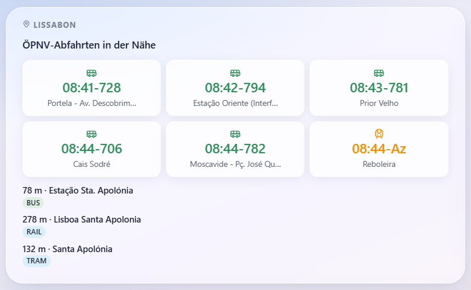

# Gladys external integration — Transitous

Hier finden sie eine externe Integration für Gladys Assistant. 
Sie zeigt die nähesten und nächsten Abfahrtsmöglichkeiten in einem frei wählbaren Umkreis um ihre Geolocation an.

Diese Entwicklung benötigt eine Installation von Gladys Assistant als Grundlage.

Ein Beispiel mit Lissabon:

Sie erhalten u.a. Fähren im Linienverkehr, Seilbahnen im Linienverkehr, Busse, Überlandbusse, Straßenbahnen, Schnellzüge etc. etc.
